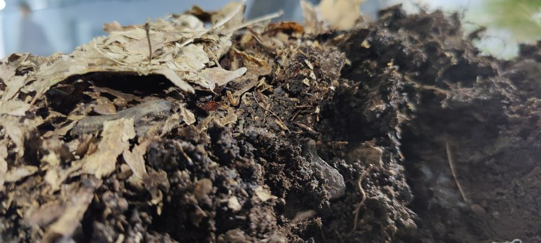

<!-- Generated by tools/prerender.py. Do not edit. -->

::: {.grid .engel-cards}

::: {.g-col-12 .g-col-md-6 .g-col-xl-3 .engel-card}
{.engel-card-photo fig-alt="Soil surface with leaf litter"}

`<i class="bi bi-grid-3x3-gap engel-card-icon" aria-hidden="true"></i>`{=html}

**[Sampling and experimental design](register.qmd#planned)**

Study design, field sampling, sampling effort and sample registration.

[in preparation]{.engel-card-count}
:::

::: {.g-col-12 .g-col-md-6 .g-col-xl-3 .engel-card}
`<i class="bi bi-bug engel-card-icon" aria-hidden="true"></i>`{=html}

**[Fauna sample processing](protocols/fauna/EnGeL-FAUNA-MAR-MORPH.qmd)**

Field sampling, extraction and sorting of soil animals.

[1 protocol]{.engel-card-count}
:::

::: {.g-col-12 .g-col-md-6 .g-col-xl-3 .engel-card}
`<i class="bi bi-droplet-half engel-card-icon" aria-hidden="true"></i>`{=html}

**[Molecular biology](protocols/molb/EnGeL-MOLB-DNA-BARC.qmd)**

Nucleic acid extraction, quality control, PCR and sequencing libraries.

[8 protocols]{.engel-card-count}
:::

::: {.g-col-12 .g-col-md-6 .g-col-xl-3 .engel-card}
`<i class="bi bi-diagram-3 engel-card-icon" aria-hidden="true"></i>`{=html}

**[Bioinformatics](protocols/bioinf/EnGeL-BIOINF-OBITOOLS4.qmd)**

From raw reads to taxonomic tables.

[1 protocol]{.engel-card-count}
:::

:::
