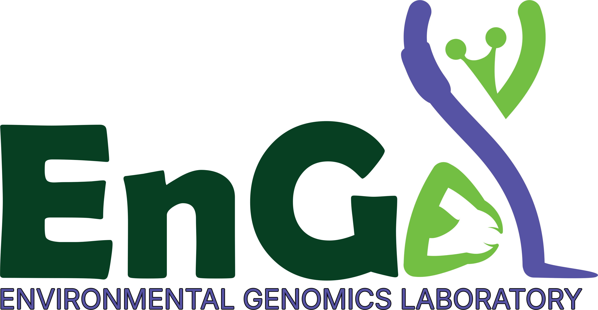

::: {.engel-hero}
{width=220px fig-alt="EnGeL – Environmental Genomics Laboratory"}

EnGeL reads the soil as an archive: of biodiversity, of adaptation, and of the long entanglement between people and the land. We work from field observation to the genome, at the meeting point of conservation biology, soil ecology and environmental genomics.

These are the methods behind that work: how we sample and sort soil animals, extract and check DNA and RNA, build metabarcoding libraries and turn sequence reads into species lists. Each protocol is a web page, a PDF and a Word file, with a one-page bench sheet for the lab.
:::

## Protocol areas



## Start here

- **[Soil fauna metabarcoding workflow](workflows/soil-fauna-metabarcoding.qmd):** from the soil core to sequence data, step by step, with the quality checks between steps.
- **[Protocol register](register.qmd):** every protocol with its version and status, and the protocols in preparation.
- **[People](people.qmd):** authors and contributors.
- **[Values to confirm](to-confirm.qmd):** what is still open in the drafts.

::: {.callout-warning title="Drafts"}
Protocols with status *draft* contain values marked [TO CONFIRM] and are not yet approved for use.
:::

**About the lab.** The Environmental Genomics Laboratory (EnGeL-UC) is part of the Environmental Ecology & Ecotoxicology Group (E3G), Centre for Functional Ecology, Department of Life Sciences, University of Coimbra · Laboratório Associado TERRA. More at [envigenomics.eu](https://envigenomics.eu/).

**Licence.** Text: CC BY 4.0. Code: MIT. Logos are the property of their institutions and are not covered by the licence.
