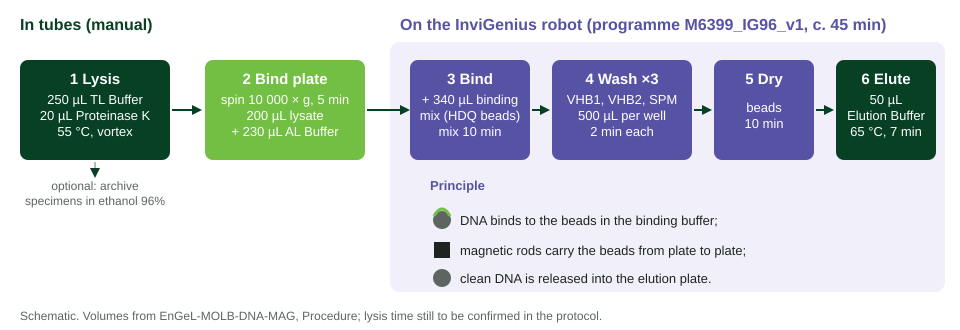

## Purpose and scope

This protocol produces purified genomic DNA from bulk soil fauna samples for DNA metabarcoding and other PCR-based analyses. DNA is purified in 96-well format on an Invitek InviGenius® automated magnetic-particle extraction robot with the Omega Bio-tek Mag-Bind® Blood & Tissue DNA HDQ 96 Kit (Cat. No. M6399).

**Sample types covered.** The procedure from lysis onwards is the same for all sample types; only the pre-treatment differs:

- Microarthropods stored in 96% ethanol (non-destructive lysis; specimens can be archived after lysis).
- Nematode suspensions in dH~2~O (unfixed aliquot, frozen).
- Macroarthropods: pre-treatment by drying and powdering [TO CONFIRM: procedure to be added].

**Limits.** Lysates are not stored (see Lysis). Throughput is one 96-well plate per run (92 samples and 4 extraction blanks). DNA extraction from soil and from eDNA samples (e.g. airborne eDNA) is not covered and will be described in separate protocols. Library preparation is described in EnGeL-MOLB-MB, and detailed DNA quality control in EnGeL-MOLB-NAQC.

## Principle

The preservation liquid is removed first: ethanol by centrifugation, pipetting and evaporation of residual ethanol in an IR vacuum concentrator; water from nematode suspensions by centrifugation and pipetting. Samples are digested in TL Buffer with Proteinase K at 55 °C. For microarthropods the approach is non-destructive: the lysate is recovered for DNA extraction and the specimens can be archived in ethanol for the collection.

An aliquot of the lysate is mixed with AL Buffer and with HDQ Binding Buffer containing Mag-Bind® Particles HDQ, to which the DNA binds. The InviGenius® moves the particles with magnetic rods through pre-filled plates: binding, two VHB washes and one SPM wash, bead drying, and elution in Elution Buffer at 65 °C. The robot does not dispense reagents; all plates are pre-filled by the operator (Omega Bio-tek, 2025; Invitek Diagnostics, n.d.).


{#fig-dnamag fig-alt="Flow diagram with six boxes: lysis in tubes; transfer of lysate to the Bind plate; then on the robot binding with beads, three washes, drying and elution in 50 µL." width="100%"}

## Before you start

| Item | Details |
|:--|:--|
| Hands-on time (full plate) | [TO CONFIRM: to be filled in by Luísa Fraga and Andreia Quaresma] |
| Total time (full plate) | [TO CONFIRM: to be filled in by Luísa Fraga and Andreia Quaresma]. Fixed times in the procedure: ethanol evaporation 15 min per concentrator load; lysis 1 h 30 min; AL mixing 10 min; robot run c. 45 min. |
| Run size | 92 samples + 4 extraction blanks (positions H3, H6, H9, H12) per 96-well plate. |
| Sample amount | [TO CONFIRM: maximum amount per extraction]. Specimens must be fully covered by the TL Buffer. |
| Sample condition and storage | Microarthropods: in 96% ethanol at room temperature; ideally in the fridge if there is space. Nematodes: unfixed aliquot in dH~2~O in 1.5 mL tubes, frozen at −20 °C or −80 °C. Macroarthropods: [TO CONFIRM]. |
| Prepare in advance | Kit buffers diluted with ethanol / isopropanol (Reagent preparation); plate map (Annex 1); dry bath at 55 °C; bench cleaned and UV on. |
| Key safety points | Guanidine-containing buffers (AL, VHB): never mix with bleach. HDQ Binding Buffer contains sodium perchlorate. See Safety and waste. |

::: {.callout-note title="NOTE"}
The IR vacuum concentrator rotor (NB-503-1524) holds 24 × 1.5 mL tubes, so a full plate needs four concentrator loads.
:::

## Materials

### Equipment

::: {.engel-equipment}
:::

### Consumables

::: {.engel-consumables}
:::

### Reagents and kits

::: {.engel-reagents}
:::

Models and catalogue numbers of general equipment and consumables are kept generic in this version.

## Reagent preparation

When opening a new kit, dilute the concentrated buffers as below and mark the bottles once done. Volumes are for kit M6399-01, from the Omega Bio-tek manual revision v8.2 [TO CONFIRM: check against manual v9.0, the revision cited in References].

| Buffer | Add | Volume (M6399-01) | Storage |
|:--|:--|:--|:--|
| SPM Buffer | 100% ethanol | 350 mL | Room temperature |
| VHB Buffer | 100% ethanol | 290 mL | Room temperature |
| HDQ Binding Buffer | 100% isopropanol | 160 mL | Room temperature |

**Storage and stability of kit components (manual v8.2)**

- Mag-Bind® Particles HDQ: 2–8 °C for long-term use.
- Proteinase K Solution: room temperature for up to 12 months; 2–8 °C for long-term storage.
- All other components: room temperature, away from bright light. Precipitates formed in cool conditions are dissolved by warming at 37 °C with gentle shaking.

<!-- bench -->
**Binding mix (prepare fresh for each run).** Prepare a master mix of HDQ Binding Buffer and Mag-Bind® Particles HDQ only for the samples to be extracted in this run (the mix does not keep). Resuspend the Mag-Bind® Particles thoroughly before pipetting. Volumes include 10% excess (see Calculations).

| Component | Per sample | 24 samples (+10%) | 48 samples (+10%) | 96 (92 samples + 4 blanks, +10%) |
|:--|--:|--:|--:|--:|
| HDQ Binding Buffer | 320 µL | 8 448 µL | 16 896 µL | 33 792 µL |
| Mag-Bind® Particles HDQ | 20 µL | 528 µL | 1 056 µL | 2 112 µL |
| Total binding mix | 340 µL | 8 976 µL | 17 952 µL | 35 904 µL |

## Procedure

### Before starting


- Set the dry bath to 55 °C.
- Check that the kit buffers have been prepared (Reagent preparation).

- When establishing a new starting material or community, include an extraction positive control (e.g. a mock community of known composition) and record its well in the plate map [TO CONFIRM: composition].

The steps below apply to 1.5 mL Eppendorf tubes. Specimens must be fully covered by the TL Buffer; for bulk samples with high biomass, scale up TL Buffer and Proteinase K proportionally or split the sample into two or more extractions (the standard 250 µL has been sufficient so far).

### Pre-treatment (choose by sample type)

**A. Microarthropods in ethanol: ethanol removal**



**B. Nematode suspensions in water: water removal**

(@) Thaw the frozen tubes containing the nematode suspension [TO CONFIRM: thawing conditions].
(@) Centrifuge the tubes at 6 000 × g for 3 min to pellet the nematodes.
(@) Carefully remove the supernatant with a pipette without disturbing the nematode pellet, leaving 50 µL of water with the nematode pellet. It might be beneficial to use fine tips and to work against a dark background to check the pellet.

**C. Macroarthropods: drying and powdering**

[TO CONFIRM: drying conditions, powdering method, and amount of powder per extraction.]

### Lysis

(@) Add 250 µL of TL Buffer to each tube.
(@) Add 20 µL of Proteinase K to each tube. Vortex at 1 500 rpm to mix.
(@) Incubate the tubes in a dry bath at 55 °C for 1 h 30 min [TO CONFIRM: 1 h 30 min in the UC v2.0 protocols; “usually 2 h” stated on 2026-11-16], vortexing at 1 500 rpm every 30 min.

::: {.callout-important title="CRITICAL"}
For non-destructive lysis of microarthropods, do not extend the incubation, so that specimens remain intact for archiving. Shorter times give less but higher-quality DNA; longer times give more but degraded DNA, particularly for soil animals.
:::

(@) Optional: add 5 µL of RNase A, vortex at 1 500 rpm to mix and leave at room temperature for 2 min.
(@) Centrifuge the tubes at 10 000 × g for 5 min to settle the specimens and debris.
(@) Transfer 200 µL of the lysate (supernatant) to a 96 deep-well plate (Bind plate), following the plate map, without aspirating specimens.
(@) Optional but desired (microarthropods): recover the specimens for archiving. Remove the remaining lysate, refill the tube with 96% ethanol and place a unique, laser-printed coded label inside the tube. Store the tubes in 96-position cryoboxes and archive them in the collection.

::: {.callout-note title="NOTE"}
Proceed immediately to the automated purification: lysates are used promptly and are not stored. A hold step for lysates has not been validated for this kit [TO CONFIRM: see Remarks for options from the literature].
:::

### Automated DNA purification (InviGenius®)

(@) Add 230 µL of AL Buffer to each well of the Bind plate. Seal the plate and mix on a plate vortex/shaker at 1 500 rpm for 10 min.
(@) In the meantime, prepare three deep-well wash plates and one deep-well elution plate:
    - W1 (VHB1 plate): 500 µL VHB Buffer per well
    - W2 (VHB2 plate): 500 µL VHB Buffer per well
    - W3 (SPM plate): 500 µL SPM Buffer per well
    - Elution plate: 50 µL Elution Buffer per well (single elution)
(@) Prepare the binding mix (HDQ Binding Buffer + Mag-Bind® Particles HDQ) only for the samples to be extracted in this run (Reagent preparation).

::: {.callout-important title="CRITICAL"}
Resuspend the Mag-Bind® Particles thoroughly before pipetting. The binding mix does not keep: prepare it only for the samples of each run.
:::

(@) DNA binding: add 340 µL of binding mix to each well of the Bind plate. Mix thoroughly by pipetting up and down 10 times.
(@) Load the robot according to the following plate positions:

| Plate | Position |
|:--|:--:|
| Tip plate | 1 |
| Bind plate (lysate + AL Buffer + binding mix) | 2 |
| VHB1 plate | 3 |
| VHB2 plate | 4 |
| SPM plate | 5 |
| Elution plate | 8 |

::: {.callout-important title="CRITICAL"}
Before starting the InviGenius® run, check that all plates are in the correct robot positions.
:::

(@) Run the protocol “M6399_IG96_v1” (c. 45 min): binding with 10 min mixing, two VHB washes and one SPM wash (2 min each), 10 min bead drying, and elution for 7 min at 65 °C. Full program parameters are given in Annex 2.
(@) Unload the plates. Transfer the eluate (purified DNA) to a labelled 96-well microplate with a red frame.
(@) Discard the Bind (lysate) plate and the deep-well elution plate in the biological hazard container. Send the wash plates to be washed and autoclaved.

### DNA storage and quality assessment



### After finishing

- Empty the liquid left in the wash plates into the biological liquid waste before sending the plates to be washed (see Safety and waste).


## Calculations

Master mix and buffer volumes for a run, with 10% excess:

$$V_\mathrm{mix} = v_\mathrm{sample} \times n \times 1.1$$

- $V_\mathrm{mix}$: volume of a component to prepare for the run (µL)
- $v_\mathrm{sample}$: volume of that component per well (µL)
- $n$: number of wells to process (samples + extraction blanks; dimensionless)
- 1.1: factor for 10% excess (dimensionless)

**Worked example** (full plate, $n$ = 96: 92 samples + 4 blanks):

- HDQ Binding Buffer: 320 µL × 96 × 1.1 = 33 792 µL
- Mag-Bind® Particles HDQ: 20 µL × 96 × 1.1 = 2 112 µL
- TL Buffer: 250 µL × 96 × 1.1 = 26 400 µL; AL Buffer: 230 µL × 96 × 1.1 = 24 288 µL
- Each wash plate (VHB1, VHB2, SPM): 500 µL × 96 × 1.1 = 52 800 µL

## Quality control

| Control | Where | Purpose | Acceptance criterion |
|:--|:--|:--|:--|
| Extraction blanks (4 per plate) | Positions H3, H6, H9, H12; processed exactly like the samples from lysis onwards | Detect contamination during extraction; spread across the plate so that cross-contamination can be traced to a position | Processed through the PCR with the samples: no band on the gel, and < 5 ng/µL on the NanoDrop (regarded as noise) |
| Extraction positive control (e.g. mock community of known composition) | When establishing a new starting material or community | Check extraction performance for the new material | [TO CONFIRM: composition and criterion] |
| DNA purity | All extracts | A~260~/A~280~ and A~260~/A~230~ (NanoDrop) | Ideal: A~260~/A~280~ 1.8–2.0 and A~260~/A~230~ 2.0–2.2. Values outside are flagged, not failed: the PCR decides |
| DNA concentration | All extracts | Fluorometry (Qubit) | General rule: ≥ 10 ng/µL success; < 5 ng/µL fail. Depends on the starting quantity and parent material; between 5 and 10 ng/µL the PCR result decides. |

The DNA concentration rule is a general guide: the PCR is the best way to evaluate whether the DNA in a sample is viable. The Metabarcoding Lab Pipeline workbook uses 10 ng/µL as its “adequate DNA” threshold when classifying PCR failures.

Negative controls are carried through library preparation and sequenced alongside the samples, so that contaminant reads can be identified and removed during bioinformatic processing (EnGeL-MOLB-MB). A PCR positive control is always included at the PCR stage (EnGeL-MOLB-MB). Details of NanoDrop and Qubit measurements: EnGeL-MOLB-NAQC.

## Data and metadata

- **Outputs:** purified DNA in labelled 96-well red-frame microplates; one plate map per plate (Annex 1); DNA purity and concentration values.
- **Sample labels** (DNA extracts have sample nature `DNA`):

  

- **Plate map:** spreadsheet (.xlsx/.csv) with one row per well plus a visual 8 × 12 grid, with a unique plate ID (e.g. Project_Marker_Plate##_YYYYMMDD). The same file is carried forward to library preparation (EnGeL-MOLB-MB).
- **Where:** extraction results go to the *Sample_Tracking* sheet of the Metabarcoding Lab Pipeline workbook (`EnGeL_LabPipeline_mesofauna_TEMPLATE`, one copy per project) and to the lab book; sample information to the sample master data file. Instrument use is recorded in the equipment user logs (NanoDrop, Qubit).

::: {.callout-note title="Minimum to record"}
- Plate ID and well; EnGeL sample label (master data file), also on any archived tube; sample type (sample, extraction blank, positive control)
- Pre-treatment used (A, B or C) and any deviation (split extraction, scaled-up lysis, optional RNase A)
- Operator
- Lot numbers: Mag-Bind® Blood & Tissue DNA HDQ 96 Kit; RNase A (if used); ethanol and isopropanol used for buffer preparation
- Robot program name (M6399_IG96_v1) [TO CONFIRM: also the robot run ID?]
- As in the Lab Pipeline *Sample_Tracking* sheet: Extraction_pipeline, Extraction_date, Equipment, DNA_ngul, A260/280, A260/230, Elution_vol_ul, DNA_total_ng
- MIxS fields: not produced at this step; recorded at sequence submission (EnGeL-MOLB-MB)
:::

## Safety and waste



**Kit hazards** (Omega Bio-tek M6399 manual; to be confirmed by the laboratory against the current kit and reagent SDS):

- AL Buffer and VHB Buffer contain guanidine hydrochloride.

- HDQ Binding Buffer contains sodium perchlorate (strong oxidiser; may cause damage to organs through prolonged or repeated exposure). Keep away from heat and combustible materials.
- Proteinase K may cause allergy or asthma symptoms if inhaled; TL Buffer may cause eye irritation and skin sensitisation.


**Waste**



For this protocol:

- Leftover lysates, buffers that have been in contact with samples, and the liquid left in the wash plates: biological liquid waste (jerrican), with a funnel. Never add bleach to this waste.
- Used Bind and elution deep-well plates, tips, tubes and gloves: biological solid waste (black bin).
- Wash plates (VHB1, VHB2, SPM): emptied into the biological liquid waste, then washed and autoclaved for reuse.
- Unused or expired kit reagents: specific hazardous waste (red bin).

## Troubleshooting

| Problem | Likely cause | Solution |
|:--|:--|:--|
| Specimens aspirated with the ethanol | Narrow tip opening; pellet disturbed | Use wide-bore tips or cut off the tip of regular tips; do not disturb the pellet. |
| Downstream PCR inhibition | Residual ethanol after evaporation | Ensure complete ethanol removal; monitor drying in the concentrator, without over-drying. |
| Specimens not covered by TL Buffer | High biomass | Scale up TL Buffer and Proteinase K proportionally, or split the sample into two or more extractions with suffixed IDs (e.g. S045a, S045b). |
| Low DNA yield | Mag-Bind® Particles not resuspended; binding mix prepared too early | Resuspend the particles thoroughly; prepare the binding mix only for the current run. Other causes and solutions: [TO CONFIRM]. |
| Specimens damaged after lysis | Incubation extended | Keep the standard incubation time for non-destructive lysis. |
| Run fails or wells empty | Plates in wrong positions | Check plate positions against the loading table before starting the run. |
| DNA detected in extraction blanks (band on the gel, or ≥ 5 ng/µL) | Contamination during extraction or handling | Identify what amplified (bioinformatics); check reagents and handling; samples of the same run are interpreted with this in mind [TO CONFIRM: when a run is repeated] |

## Remarks

When handling specimens, all materials used such as forceps and spatulas are cleaned with sodium hypochlorite (3%) and 96% ethanol.

The protocol may require optimisation and validation for specific taxonomic groups and sample types.

**Lysis time.** The standard incubation is used for soil fauna. Overnight lysis is needed for some eDNA samples (e.g. airborne eDNA), which will be described in separate eDNA protocols. Shorter times give less but higher-quality DNA; longer times give more but degraded DNA, particularly for soil animals.

**Holding lysates: options from the literature, not validated in the lab [TO CONFIRM].** The lab recommendation is to use lysates promptly. Options reported elsewhere:

- Qiagen states that, after Proteinase K digestion, tissue samples can be stored in its Buffer ATL (DNeasy Blood & Tissue Kit) for up to 6 months at ambient temperature without loss of DNA quality (Qiagen, n.d.). This applies to a different kit buffer, not to Omega TL Buffer.
- In the LIFEPLAN non-destructive Malaise-trap protocol, part of each lysate is archived for future analysis, but no storage temperature or duration is given (LIFEPLAN, 2024).
- The Omega Bio-tek manual (v8.2) gives no lysate storage step; it gives storage of the purified DNA at −20 °C.

**Robot volume setting.** The Bind step volume setting is 770 µL (200 µL lysate + 230 µL AL Buffer + 340 µL binding mix). The program file exported on 2026-06-30 shows 980 in this field: check the program on the robot [TO CONFIRM].

## References

Invitek Diagnostics (n.d.). InviGenius® 96 – User Manual. Invitek Diagnostics, Berlin, Germany.

LIFEPLAN (2024). LIFEPLAN Malaise sample metabarcoding. protocols.io. <https://www.protocols.io/view/lifeplan-malaise-sample-metabarcoding-dbfq2jmw>

Omega Bio-tek (2025). Mag-Bind® Blood & Tissue DNA HDQ 96 Kit (M6399) – Product Manual, revision v9.0 (December 2025; QMF27.0118.M6399). Omega Bio-tek Inc., Norcross, GA, USA. Revision v8.2 used for the reagent preparation volumes and storage conditions.

Qiagen (n.d.). FAQ-3362: Is it possible to stop the DNeasy tissue protocol and store the tissue lysates after digesting in buffer ATL and Proteinase K? <https://www.qiagen.com/us/resources/faq/3362>

## Version history and citation

::: {.engel-history}
:::

## Open questions

1. Lysis time: 1 h 30 min (UC v2.0) or 2 h (stated 2026-11-16)?
2. IR vacuum concentrator: temperature setting (instrument range 35–60 °C).
3. Macroarthropod pre-treatment: drying conditions, powdering method, amount per extraction.
4. Thawing conditions for frozen nematode aliquots.
5. Hands-on and total time for a full plate; maximum sample amount per extraction (Luísa Fraga, Andreia Quaresma).
6. Composition of the extraction positive control.
7. Robot program: the Bind volume field shows 980 in the exported file; the setting should be 770 µL.
8. Reagent preparation volumes: check against Omega manual v9.0.
9. RNase A: supplier and concentration.
10. Holding lysates: adopt one of the literature options, or keep “no storage”?
11. Record the robot run ID?
12. Troubleshooting: when a run with DNA in a blank is repeated; other causes of low yield.
13. Author order; DOI.
14. Materials list 2 mL nuclease-free microcentrifuge tubes (from the UC protocols), but no step uses them: keep or remove?

## Annex 1 – Plate map guidance {.unnumbered}



## Annex 2 – InviGenius® program M6399_IG96_v1 {.unnumbered}

Program exported from the InviGenius® 96 (program date 2026-06-30; 7 steps). Parameters are decoded below following the program editor fields described in the InviGenius® 96 user manual (section 4.3.3, “Manage Program”). The robot does not dispense reagents: all plates are pre-filled as described in the Procedure.

**A. Plate positions and mixing parameters**

| Step | Pos. | Content | Mix time (min) | Mix amp. (%) | Wait (min) | Volume setting (µL) | Mix speed (1–10) | Temp. (°C) |
|:--|:--:|:--|--:|--:|--:|--:|--:|--:|
| -Load- | 1 | Tip plate – tip loading | – | – | – | – | – | – |
| Bind | 2 | Lysate + AL Buffer + binding mix (770 µL) | 10.0 | 80 | 0 | 770 (see note) | 7 | off |
| VHB1 | 3 | VHB Buffer, 500 µL | 2.0 | 80 | 0 | 500 | 7 | off |
| VHB2 | 4 | VHB Buffer, 500 µL | 2.0 | 80 | 0 | 500 | 7 | off |
| SPM | 5 | SPM Buffer, 500 µL | 2.0 | 80 | 10.0 (bead drying) | 500 | 7 | off |
| Elute | 8 | Elution Buffer, 50 µL | 7.0 | 80 | 0 | 50 | 5 | 65 |
| -Unload- | 5 | Tip unloading | – | – | – | – | – | – |

**B. Magnetic collection parameters**

| Step | Segments (0–5) | Cycle times (0–10) | Mag. speed (1–10) | Lip-lvl (s) | Anti-splash (s) | Segment times (s) |
|:--|--:|--:|--:|--:|--:|--:|
| Bind | 2 | 2 | 1 | 0 | 0 | 8 + 8 |
| VHB1 | 2 | 2 | 1 | 0 | 0 | 4 + 4 |
| VHB2 | 2 | 2 | 1 | 0 | 0 | 4 + 4 |
| SPM | 2 | 2 | 1 | 0 | 0 | 4 + 4 |
| Elute | 2 | 2 | 1 | 0 | 0 | 8 + 8 |

Field definitions (InviGenius® 96 manual): Mix time – mixing time in the selected plate; Mix amp. – mixing amplitude (1–100%); Wait time – interval before the next step (after the SPM wash this dries the beads before elution); Volume – liquid volume used by the software to convert mixing amplitude; Mix speed – 1 (slowest) to 10 (fastest); Temp. – heating, available only at positions 2 and 8; Segments/Cycle times – number of magnetic collection segments and repeats; Mag. speed – speed of the magnetic rods below the liquid level; Lip-lvl / Anti-splash – standing times at / above the liquid surface; Segment times – magnetic collection time per segment (only the first two apply when Segments = 2).

::: {.callout-note title="NOTE"}
Mix and wait times are stored in the program file in tenths of a minute (e.g. 100 = 10.0 min), which is consistent with the c. 45 min run time. The Bind volume field in the exported file reads 980; the setting should be 770 µL [TO CONFIRM].
:::

**Program file (M6399_IG96_v1.txt)**

```text
AS180_S
NAME:M6399_IG96_v1
STEP:7
STATUS:10
TIME:2026-06-30 08:52:55
OPTION:1 1 1 1 1 1 1 1 1 5 0 1 0 1 2 5 0 2
-Load- 1 0 1 0 5 1 0 1 0 1 0 0 0 0 0 0 0
Bind 2 100 80 0 980 7 0 2 2 1 0 0 8 8 1 1 1
VHB1 3 20 80 0 500 7 0 2 2 1 0 0 4 4 1 1 1
VHB2 4 20 80 0 500 7 0 2 2 1 0 0 4 4 1 1 1
SPM 5 20 80 100 500 7 0 2 2 1 0 0 4 4 1 1 1
Elute 8 70 80 0 50 5 65 2 2 1 0 0 8 8 1 1 1
-Unload- 5 0 1 0 5 1 0 1 0 1 0 0 0 0 0 0 0
AS180_E
```
