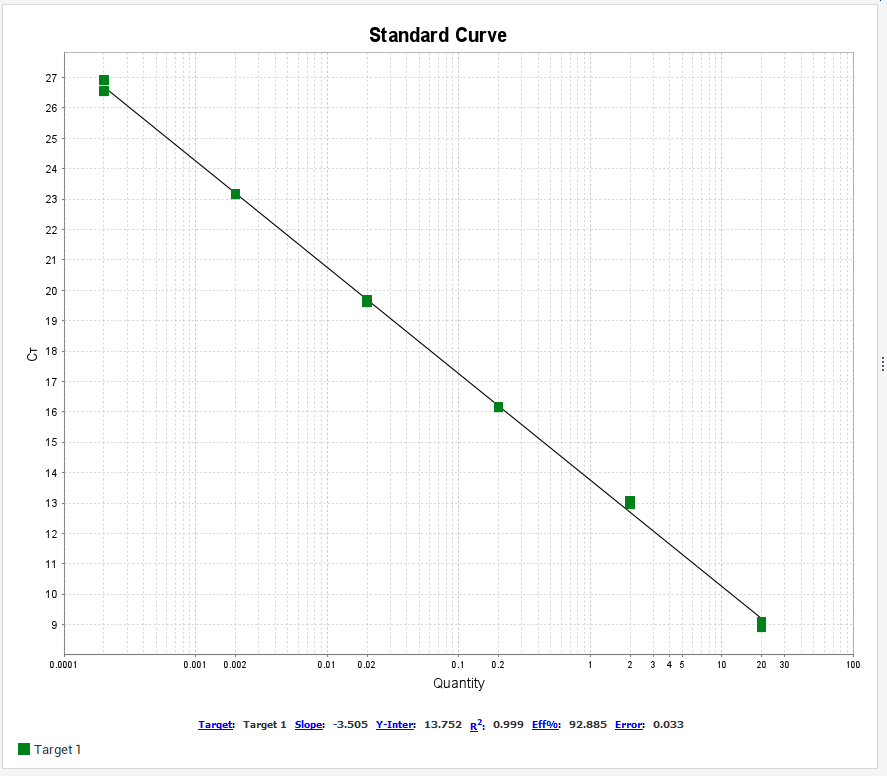

## Purpose and scope

This protocol determines the molar concentration of Illumina sequencing libraries (pooled amplicon libraries) by qPCR, before dilution for sequencing. It is used at the end of library preparation (EnGeL-MOLB-MB). It measures only molecules carrying the Illumina P5/P7 adapter sequences.

## Principle

The library is diluted into the range of six DNA standards of known concentration. Library and standards are amplified with primers that bind the P5 and P7 adapter sequences, using a SYBR Green qPCR master mix. The Ct values of the standards give a standard curve, from which the concentration of each library dilution is read and corrected for the difference in size between the standard (452 bp) and the library (KAPA Library Quantification Kit, Roche).

## Before you start

| Item | Details |
|:--|:--|
| Hands-on time | 1 h |
| Total time | 2 h 30 min |
| Sample | 1 µL of the pooled, bead-cleaned library (for the 1:1 000 intermediate dilution); average fragment size measured on the TapeStation; PicoGreen or Qubit concentration known |
| Prepare in advance | Combined Master Mix + Primer Mix (first use of the kit); plate layout; standards thawed on ice |
| Key safety points | See Safety and waste |

## Materials

### Equipment

::: {.engel-equipment}
:::

### Consumables

::: {.engel-consumables}
:::

### Reagents and kits

::: {.engel-reagents}
:::

## Reagent preparation

- **Combined Master Mix + Primer Mix:** see the first steps of the Procedure (first use of the kit only).
- **Library dilution buffer:** 10 mM Tris-HCl pH 8.0–8.5 + 0.05% Tween 20 [TO CONFIRM: preparation, storage and shelf life].

## Procedure

### Before starting



### Quantification



### After finishing



## Calculations



## Quality control

Accept the run before calculating:



::: {.callout-note title="Expected results"}
{#fig-kapa-melt fig-alt="Melt curve plot with derivative fluorescence against temperature; library and control curves share one peak, the standards peak at a slightly higher temperature, and the no-template control is flat." width="80%"}

{#fig-kapa-std fig-alt="Standard curve: Ct against log quantity for six standards, falling on a straight line from Ct 9 to Ct 26." width="80%"}
:::

## Data and metadata

- **Outputs:** exported qPCR results (.csv); library concentration (nM) per library, averaged over valid dilutions.
- **Where:** the *Library_QC* sheet of the Metabarcoding Lab Pipeline workbook [TO CONFIRM] and the lab book; instrument use in the QuantStudio 3 user log.

::: {.callout-note title="Minimum to record"}
- Library / pool ID and EnGeL label
- Run date, operator, instrument (QuantStudio 3)
- KAPA kit lot number
- Dilutions run; Quantity Mean per dilution; library size used (bp); final concentration (nM)
- Run QC values (efficiency, R², NTC)
:::

## Safety and waste



**Waste**



For this protocol: used qPCR plates, tips and tubes go to biological solid waste (black bin) [TO CONFIRM].

## Troubleshooting

| Problem | Likely cause | Solution |
|:--|:--|:--|
| Diluted library outside the standard range | Wrong dilution for the library concentration | Use the PicoGreen value to choose dilutions; add the 1:100 000 dilution if PicoGreen > c. 50 nM. |
| ΔCt between dilutions not c. 1.0 | Pipetting or dilution error | Repeat the dilutions, vortexing and spinning each one. |
| Extra melt-curve peak | Primer dimers or non-specific product | [TO CONFIRM]; see also the kit technical data sheet (Roche, KR0405). |
| Signal in the NTC | Contamination | [TO CONFIRM] |

## Remarks

The standard is 452 bp; the size correction uses the average fragment size measured on the TapeStation.

## References

Roche (n.d.). KAPA Library Quantification Kit – Illumina Platforms. Technical data sheet KR0405, v8.17. Troubleshooting: <https://rochesequencingstore.com/wp-content/uploads/2017/10/KAPA-Library-Quantification-Kit-for-Illumina.pdf>

## Version history and citation

::: {.engel-history}
:::

## Open questions

1. Authorship (author or contributor model for the handbook, pending); DOI.
2. Kit catalogue number.
3. Positive control: product and catalogue number; acceptance criterion.
4. Library dilution buffer: the source calls it “TE pH = 8” but gives 10 mM Tris-HCl + 0.05% Tween 20 (no EDTA). Name, preparation and storage?
5. Where results are recorded (Lab Pipeline *Library_QC* sheet?).
6. Troubleshooting: action for extra melt-curve peaks and for signal in the NTC.
7. Waste route for used plates.
